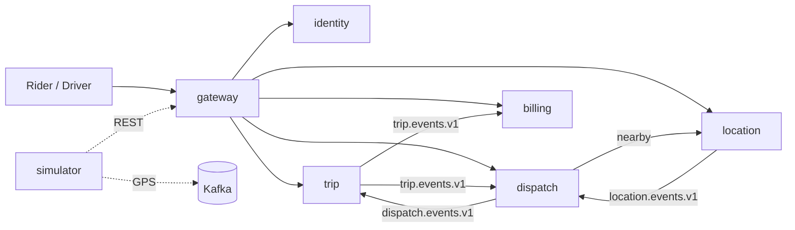
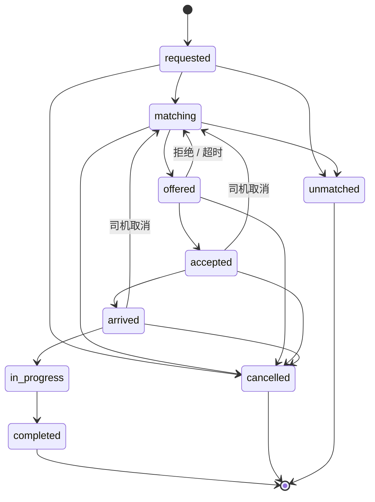

# RideGo

单城市的类 Uber 网约车系统：微服务 + 事件驱动 + DDD + CQRS。

## 项目简介

Rider 发起 Trip，Dispatch 依次向最近的空闲 Driver 发出限时 Offer；司机接受后前往上车点、开始并完成行程，Billing 生成零金额账单。系统按生产形状组织：独立服务、Kafka 事件链、每服务独立数据库与 outbox、CQRS 读模型、Redis GEO、Prometheus / Grafana。

规模目标：单城市 **10,000** 在线司机、峰值 **1,000–2,000** 并发行程、GPS **3 秒/次**（≈3.3k msg/s）。

## 架构

| 服务 | 职责 |
|---|---|
| `gateway` | 统一入口、JWT 校验与路由 |
| `identity` | 账号、登录、JWT 签发 |
| `trip` | Trip 状态机、读模型、分享令牌 |
| `dispatch` | 匹配、顺序 Offer、司机可用性 |
| `location` | GPS 摄入、Redis GEO、在线判定、行程轨迹 |
| `billing` | 账单与模拟支付 |
| `simulator` | 万级司机 GPS 与乘客 / 司机行为模拟 |



### Trip 状态机



### 一致性

- 写模型状态 CAS，事件与业务写入同事务进入 outbox，至少一次投递
- 有副作用的消费者按 `eventId` 去重；状态守卫型消费者以幂等操作为准
- 司机分配由 Redis 抢占键 + PostgreSQL 唯一约束双重保证，不产生重复派单
- 读模型由事件投影维护，接受短暂最终一致

## 技术栈

Java 21 · Spring Boot 4.1.1 · Spring Cloud Gateway · PostgreSQL 16.15 · Redis 7.4.11 · Kafka 4.1.2 · Prometheus 3.14 · Grafana 13.2.2 · Maven 多模块 · Testcontainers

## 快速开始

前置：Java 21、Docker + Docker Compose、`curl`。

```bash
git clone https://github.com/cd-water/ridego.git
cd ridego
bash ops/run-local.sh up
```

脚本会启动基础设施、构建 jar、后台启动六个服务并等待健康；日志与 PID 在 `ops/.run/`。

```bash
# 跑一次完整行程（下单 → 接单 → 完成 → 账单）
SIM_SCENARIO=happy java -jar simulator/target/simulator-0.0.1-SNAPSHOT.jar

# 停止应用（保留基础设施与数据）
bash ops/run-local.sh down
```

种子账号：`rider1 / ridego`（乘客）、`driver1 / ridego`（司机）。

```bash
curl -s http://localhost:8080/api/v1/auth/login \
  -H 'Content-Type: application/json' \
  -d '{"username":"rider1","password":"ridego"}'
```

端口：gateway `8080` · identity `8081` · trip `8082` · dispatch `8083` · location `8084` · billing `8085`。

<details>
<summary>可复现容器模式（备选）</summary>

先构建 jar，并确保能拉取 `eclipse-temurin:21-jre`：

```bash
bash ./mvnw -DskipTests package
docker compose -f ops/docker-compose.yml --profile app up -d
docker compose -f ops/docker-compose.yml --profile app --profile simulator \
  run --rm -e SIM_SCENARIO=happy simulator
PROM_CONFIG=prometheus-app.yml \
  docker compose -f ops/docker-compose.yml --profile app --profile monitoring up -d
```

容器与宿主 JVM 模式占用相同端口，二选一。

</details>

## 验证

| 项目 | 结果 |
|---|---|
| 测试 | 102 个，0 失败（`bash ./mvnw clean test`，Testcontainers） |
| E2E | happy / cancel / timeout / heartbeat，4/4 |
| 负载 | 10,000 司机 · 100 单/分钟 · 2 分钟：200 行程，matchRate 0.995，completionRate 0.920，accept→事件 p95 517ms，重复分配 0 |
| 可观测性 | Prometheus 7/7 targets、4 条告警、Grafana `RideGo` 看板 |

负载为 2 分钟冒烟，设计基线中的 30 分钟长稳未在此表重复运行。

## 可观测性

```bash
PROM_CONFIG=prometheus.yml \
  docker compose -f ops/docker-compose.yml --profile monitoring up -d
```

- Prometheus `http://localhost:9090`，Grafana `http://localhost:3000`（`ridegrafana / ridegrafana`）
- 业务指标：`ridego_trips_*`、`ridego_offers_*`、`ridego_positions_ingested_total`、`ridego_invoices_paid_total`

## 文档

- 系统设计：[`docs/design.md`](docs/design.md)
- 领域术语：[`GLOSSARY.md`](GLOSSARY.md)
- 架构决策：[`docs/adr/`](docs/adr/)
- 运行手册：[`docs/runbook.md`](docs/runbook.md)

## 范围与限制

v1 不做：ETA / 路径规划、双向评价、拼车、预约、动态调价、多城市、真实支付。

当前范围：单城市、零金额账单、本地默认宿主 JVM 模式（见 [ADR-0005](docs/adr/0005-local-run-mode.md)）。

已知边界：负载下偶发 `409 trip changed concurrently`（Offer 过期与接单竞争，由状态 CAS 拦截，不产生重复分配）；容器模式已通过 Compose 配置校验，运行时验证依赖可拉取的 JRE 镜像。

## License

[MIT](LICENSE)
